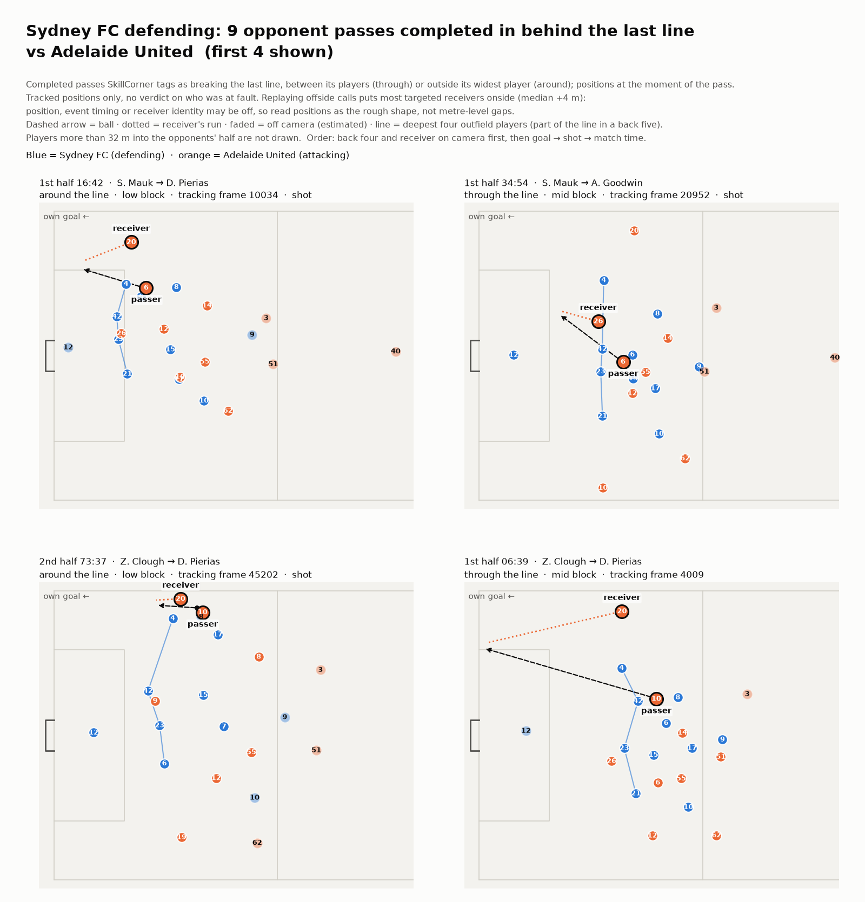

# backline — the passes that beat your back line, on one page after the match

**In one line:** SkillCorner's event data tags passes that break a team's last line; `backline` gathers the completed ones into a page of scene cards drawn from tracking, adds a back-line match report, and shows how much the camera actually saw. Extra judgements we tried (offside, who was left behind, the usual line) did not hold up when tested, so they are left out.

## Why

Moments when the back line is beaten are a natural starting point for a defensive review; `backline` lists them with the match clock so they can be found in the video.

## Use

```bash
pip install .
python -m backline 1996435 --team 869 --scenes
```

The first run downloads that match (about 90 MB) from a pinned commit of the SkillCorner open data. Leave out `--team` for both teams. Each team gets a match report, plus scene cards with `--scenes`, written to `reports/`:

1. **Scene cards** (Figure 1): every completed opponent pass SkillCorner tags as breaking the last defensive line, between its players (through) or outside its widest player (around). Incomplete attempts are left out by default (`--include-failed` adds them); dribbles and runs are not covered. Across the 20 A-League 24/25 matches there are 0 to 9 per team-match, 113 in total (58 through, 55 around).
2. **Match report**: line height, width and spread (low and mid block), ball-side shift and moving together, each against the league.



**Figure 1.** Sydney FC v Adelaide United, the first 4 of 9 cards (`--max-scenes 4`). Each card shows the match clock, passer and receiver, through or around, the defensive phase, the tracking frame (10 fps), and any shot or goal. The pitch shows player positions at the moment of the pass (players more than 32 m into the opponents' half are not drawn), the ball's path (dashed arrow) and the receiver's run (dotted). Faded players were off camera (estimated positions); fully on-camera cards come first. Read positions as the rough shape, not metre-level gaps.

### Other matches and leagues

It should run on any match in the same SkillCorner open-data format (tested on the 20 A-League 24/25 matches): point `BACKLINE_DATA` at a folder with a `matches.json` listing the match ids and, per match, `<id>/<id>_tracking_extrapolated.jsonl`, `_dynamic_events.csv`, `_phases_of_play.csv` and `_match.json`. League dots and reliability are A-League 24/25 values; rebuild them with `python -m backline.league`. Event-only data cannot be used. (This submission uses only the matches provided for the Cup.)

## Only what the camera saw

SkillCorner tracking comes from broadcast video; players outside the frame get estimated positions. All four back-line players are on camera in 71% of low-block frames, 31% of mid-block frames and 3% of high-block frames overall; a typical team-match had about 2 seconds of its roughly 4 minutes of high block on camera. So `backline`:

- computes report metrics only from moments when all four are on camera, prints how many seconds that was, and marks the high block "not calculated". Mid-block values therefore describe moments with the ball near the line (a weaker version of this bias affects the low block);
- shows each number with the sampling error among this match's on-camera moments (90%, resampling defensive phases; tracking error and camera selection are not included), against league dots that come from different amounts of on-camera time and give context, not a team ranking;
- gives every metric's league reliability: first half against second half, and match to match within the same team (39 team-matches, 13 teams). Across matches, five of nine metric–block pairs did not repeat detectably (width, ball-side shift, moving together, low-block spread, mid-block height; r −0.28 to 0.27) and the rest reach only r 0.39–0.44, so no metric is presented as a team's habit.

## What we tried and dropped

Each was tested; failures were left out.

**Table 1.** Features tested and dropped

| Feature | Test | Result | Decision |
|---|---|---|---|
| "Would have been offside if the line had held" | Replay the 62 passes called offside | Only 6 of 62 come out offside at the pass frame; targeted receivers a median +4 m onside (position, event timing or receiver identity may be off) | Dropped; cards warn not to read metre-level gaps |
| Flag a defender left 2 m+ behind the line | On-camera status and timing sensitivity of the 14 flags | 8 used off-camera estimates; 5 vanished within ±0.5 s (1 not checkable); only 4 were on camera and stable | Dropped |
| Overlay the team's "usual line" in that match | Test written before running ([docs](docs/usual_line_test.md)): 54 beaten scenes vs similar moments | Gap from usual 2.9 m vs 3.5 m (p = 0.12); 46% of ordinary moments are already 3 m+ away | Dropped |
| Mid-block "ball in front of line" | On-camera vs estimate-inclusive value | On-camera moments favour the ball near the line; typically ~9 m apart (up to ~18 m), teams reorder | Removed from the report |

So `backline` does not judge who was at fault: it shows which moments these were and roughly where everyone stood, and leaves the judgement to the coach watching the video.

## Reproduce and test

- Data is not included; `backline/data.py` downloads it from a pinned commit.
- `python -m backline.league` rebuilds `league_reference.csv` and `reliability.json`.
- Tests: `pip install ".[test]"` then `pytest` (2 synthetic, 4 on real matches; downloads two more matches), also run in GitHub Actions.
- `audit/` holds the research notes behind Table 1 (not one-command reproductions).

## Notes

- Licence: MIT (`LICENSE.md`).
- Data: SkillCorner × PySport open data (A-League 24/25) only.
- AI use: Claude (Anthropic) helped write and review the code. Study design, judgements and final review are the author's.
