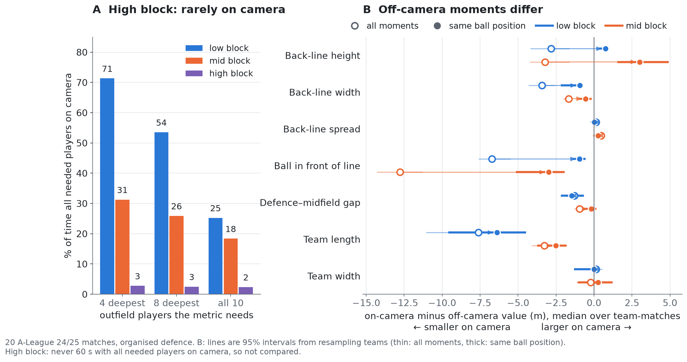

# backline — can you trust this defensive metric from broadcast tracking?

**Short answer, for 20 A-League 24/25 matches: only in the low block, and not yet as a team trait.**

- **The high block is out of sight.** All four deepest defenders are on camera 3% of the time; whole-team shape 2%.
- **What the camera misses is different football.** Metrics read up to 13 m (median) differently when a needed
  player is off camera. With the ball in the same place, most of this goes for "ball in front of the line" and
  back-line width, and back-line height *reverses*: the line is 0.8–3 m deeper when one of the four is off camera.
  Team length stays 2.5–6.4 m apart.
- **No metric repeated as a team trait**, but with 1–7 matches per team a moderate effect would usually be missed.

`backline.trust` runs these checks on any team-level defensive metric, so an analyst knows whether a number belongs
in an opposition report before it is read as "how this team defends".

## Why

Defensive shape needs several players at once, but the camera follows the ball. Broadcast visibility limits (Bassek
et al., *Sci. Med. Football*, 2025), metric repeatability (Franks et al., 2016) and filling in off-screen players
(the author's arXiv:2607.11548) are known; this asks, per block and for any metric, whether the number holds up.

## Quickstart

```bash
git clone https://github.com/nowayfootball/backline && cd backline
python3 -m venv .venv && source .venv/bin/activate   # Python 3.10 or newer
pip install -e ".[test]" -c constraints.txt         # tested versions
pytest                                               # 12 tests, downloads 3 matches (~1 min)
python -m backline.trust                             # Table 1 -> trust_table.csv (downloads 20 matches, 1.8 GB)
python -m backline.trust_figure                      # Figure 1 -> figures/fig1_trust.png
```

Data (not included) comes from a pinned SkillCorner open-data commit into `~/.cache/backline` (`BACKLINE_DATA`).

## Check your own metric

```python
from backline import trust
gap = lambda d: ((d.x4 + d.x5 + d.x6 + d.x7) - (d.x0 + d.x1 + d.x2 + d.x3)).median() / 4
print(trust.check(gap, uses=range(8)))     # defence-midfield gap, needs the 8 deepest players
```

The function gets one team's organised-defence frames from one match: `x0..x9`, `y0..y9` (outfield players by depth,
own goal at x = −52.5), `d0..d9` (on camera?), `ball_x`, `ball_y`. Blocks are SkillCorner's phase tags. `check`
returns every Table 1 number per block, with intervals and n (columns: `backline.trust` docstring).

## Results



**Figure 1.** A: share of organised-defence time with every needed player on camera. B: on- minus off-camera value
(same ball position = 5 m along × three bands across).

**Table 1.** Seven common metrics, low / mid block, 20 matches. Brackets: team-matches compared; r uses 36–39 (18–20
for 10-player metrics).

| Metric (players needed) | On camera | On − off, same ball position | Rank agreement on/off (ρ) | Repeat across a team's matches (r) | Use for |
|---|---|---|---|---|---|
| Back-line height (4) | 71% / 31% | +0.8 / +3.0 m [16 / 28] | 0.33 / 0.63 | 0.39 / 0.27 | low ✓ · mid ✗ |
| Back-line width (4) | 71% / 31% | −0.9 / −0.6 m [16 / 28] | 0.77 / 0.79 | 0.08 / −0.01 | low ✓ · mid ranking |
| Back-line spread (4) | 71% / 31% | 0.0 / +0.3 m [16 / 28] | 0.58 / 0.58 | 0.22 / 0.40 | low ✓ · mid ✗ |
| Ball in front of line (4) | 71% / 31% | −1.0 / −3.0 m [16 / 28] | 0.58 / 0.26 | 0.44 / 0.08 | low ✓ · mid ✗ |
| Defence–midfield gap (8) | 54% / 26% | −1.5 / −0.2 m [21 / 24] | 0.50 / 0.77 | 0.21 / 0.26 | low ✓ · mid ranking |
| Team length (10) | 25% / 18% | −6.4 / −2.5 m [11 / 17] | 0.65 / 0.58 | 0.52 / −0.20 | ✗ · ✗ |
| Team width (10) | 25% / 18% | 0.0 / +0.3 m [11 / 17] | 0.44 / 0.71 | −0.34 / 0.40 | ✗ · mid ranking |

How to read it:

- **Use for**: a rule of thumb set after seeing the results. ✓: needed players on camera at least half the time.
  *Ranking*: less, but team-matches keep their order on and off camera (ρ ≥ 0.7), so compare matches rather than
  quote metres. ✗: neither (high block: all).
- **Sign**: negative means smaller on camera (deeper line, narrower, ball closer, shorter team).
- **Same ball position** removes *which* moments the camera shows. The rest mixes estimation error with players
  off camera *because of where they stand* (a defender dropping deep leaves the picture); the data cannot tell which.
  Rules were fixed before running (after a review had seen the sign flip) and checked on synthetic data
  ([docs](docs/trust_metrics.md)).
- **Team trait**: no r survived false-discovery correction (lowest permutation p = 0.05). A team effect explaining
  40% of the variance would be detected 14–48% of the time at these sample sizes (`audit/trust_power.py`).

## Scene cards

`python -m backline 1996435 --team 869 --scenes` draws a match report and a card per opponent pass tagged as
breaking the last line (113; [example](figures/fig_scenes_en.png)). Cards blame no one: fault judgements we tried,
such as replaying offside calls (6 of 62 reproduced), failed ([test](docs/usual_line_test.md)).

## Other matches and leagues

Same SkillCorner format (tested on these 20 only): put `matches.json` (`[{"id": ...}]`) and `<id>/` folders in
`BACKLINE_DATA`, run `python -m backline.league --out my_league`, then `BACKLINE_LEAGUE=my_league python -m backline <id>`.
This submission uses only the provided matches.

## Notes

- Tests: synthetic (off-camera error, ball-position selection, planted team effect) on Python 3.10–3.12, real
  matches on 3.11, in CI. `audit/`: research notes.
- Licence: MIT (`LICENSE.md`). Data: SkillCorner × PySport open data (A-League 24/25) only.
- AI use: Claude (Anthropic) helped write and review the code. Study design, judgements and final review are the author's.
