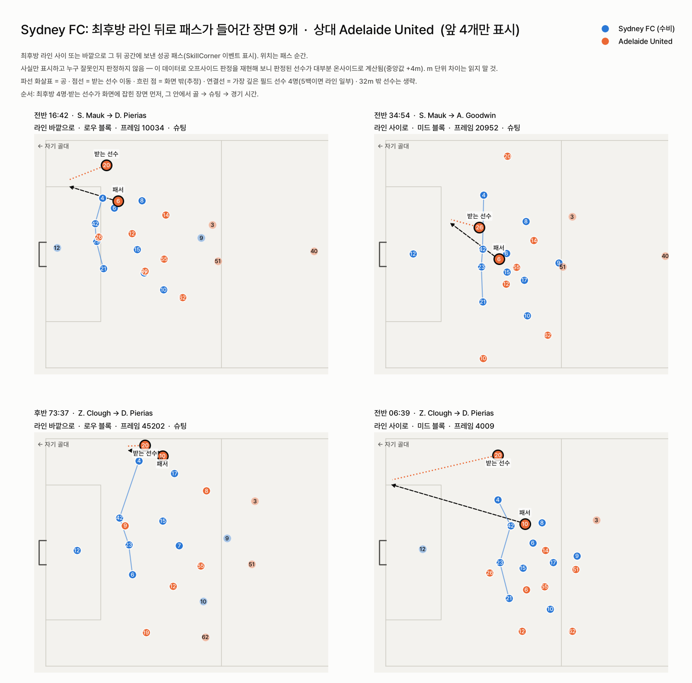

# backline — 최후방 라인 뒤로 패스가 들어간 장면, 경기 후 바로 찾기

**한 줄 요약:** SkillCorner 중계 트래킹으로 "우리 최후방 라인 뒤로 상대 패스가 들어간 순간"을 모두 찾아 장면 카드로 보여주는 도구입니다. 그리고 이 데이터로 **말할 수 없는 것**을 직접 시험해 보고 기능에서 뺐습니다.

## 왜 필요한가

경기 후 영상 미팅에서 수비 코치가 가장 먼저 찾는 장면은 "라인이 뚫린 순간"입니다. 지금은 90분 영상을 돌려 보며 직접 찾습니다. `backline`은 경기 하나를 넣으면 그 장면들을 경기 시각과 함께 한 장에 모아 줍니다. 코치는 시각을 보고 영상에서 바로 해당 장면을 틀면 됩니다.

## 사용법

```bash
pip install .
python -m backline 1996435 --team 869 --scenes --lang ko --font Pretendard.otf
```

처음 실행하면 해당 경기 데이터(약 90MB, SkillCorner 공개 데이터의 고정 커밋)를 내려받습니다. 팀마다 두 장이 나옵니다.

1. **장면 카드**(그림 1): 상대가 우리 최후방 라인 사이나 바깥으로 그 뒤 공간에 성공시킨 패스 전부(SkillCorner 이벤트 표시). A리그 24/25 20경기 기준으로 팀-경기당 0~9개, 모두 113개(라인 사이 58·바깥 55)입니다.
2. **경기 리포트**: 로우·미드 블록별 라인 높이·폭·앞뒤 흩어짐, 볼 쪽 이동, 함께 움직임을 리그 분포 위에 보여줍니다.



**그림 1.** 시드니 FC 대 애들레이드 유나이티드 경기. 각 카드에는 전·후반 경기 시각, 패서→받는 선수, 라인 사이/바깥, 수비 블록, 영상 프레임 번호, 슈팅·골 여부가 붙습니다. 그림은 패스 순간 22명의 위치, 공 경로(파선 화살표), 받는 선수의 침투(점선)를 보여줍니다. 흐린 점은 그 순간 화면 밖에 있어 위치가 추정값인 선수입니다. 최후방 4명과 받는 선수가 모두 화면에 잡힌 장면을 먼저 보여줍니다.

### 다른 경기·다른 리그에 쓰기

SkillCorner 형식이면 어떤 경기든 됩니다. 경기마다 `<id>_tracking_extrapolated.jsonl`, `<id>_dynamic_events.csv`, `<id>_phases_of_play.csv`, `<id>_match.json`이 든 폴더를 `BACKLINE_DATA`로 지정하면 됩니다. 장면 카드는 그것만으로 충분합니다. 리포트의 회색 비교 점과 지표 신뢰도는 A리그 24/25 기준값이라, 다른 리그라면 `python -m backline.league`로 그 리그 경기들로 다시 만들면 됩니다. 트래킹이 없는 이벤트 데이터만으로는 쓸 수 없습니다.

## 화면에 잡힌 것만 쓴다

SkillCorner 트래킹은 중계 영상에서 뽑은 데이터라서, 카메라가 공을 따라가는 동안 화면 밖에 있는 선수의 위치는 추정해서 채웁니다. 최후방 4명이 모두 화면에 잡히는 비율은 로우 블록 71%, 미드 블록 31%, 하이 블록 3%입니다(하이 블록은 한 경기 중앙값 2초). 그래서 `backline`은 다음 규칙을 따릅니다.

- 리포트 지표는 4명이 모두 화면에 잡힌 순간만으로 계산합니다. 측정할 수 있었던 시간을 숫자 옆에 적고, 하이 블록은 "계산하지 않음"으로 표시합니다.
- 숫자마다 이 경기 안의 표본 오차(90%, 수비 국면 재표집)를 막대로 보여줍니다. 지표 신뢰도도 함께 적습니다. 리그 전체 기준으로 같은 경기 전·후반 상관과 다른 경기 간 상관입니다.
- 라인 폭, 볼 쪽 이동, 함께 움직임은 같은 팀이라도 경기가 바뀌면 거의 재현되지 않습니다(다른 경기 간 r −0.28~0.08). 리포트는 이 값들을 "이 경기 값"으로만 설명하고 팀 성향이라고 부르지 않습니다.

## 해 봤지만 뺀 것

도구를 만들면서 더 많은 것을 말해 보려 했습니다. 하지만 각 기능을 데이터로 시험해 보고, 통과하지 못한 것은 넣지 않았습니다.

**표 1.** 시험했다가 뺀 기능

| 시도한 기능 | 시험 | 결과 | 결정 |
|---|---|---|---|
| "라인에 맞췄다면 오프사이드였다" 판정 | 심판 오프사이드 패스 62개 vs 정상 패스 761개 | 판정 구분 AUC 0.64, 오프사이드 판정 선수가 중앙값 +4m 온사이드로 계산됨 | 판정 기능 제외, m 단위 차이는 읽지 말라고 명시 |
| 혼자 2m 이상 처진 수비수 표시 | 표시된 14건의 화면 상태와 시점 민감도 | 8건이 화면 밖 추정 위치, 패스 시점 ±0.5초에 6건 소멸 | 제외 |
| 이 경기의 "평소 라인" 겹쳐 보기 | 사전 고정한 검정: 뚫린 54장면 vs 비슷한 상황 순간 | 평소와의 차이 2.9m vs 3.5m(p=0.12), 평소에도 46%가 3m 이상 벗어남 | 제외 |
| 미드 블록 "라인 앞 공까지 거리" | 화면 안 값 vs 추정값 포함 값 | 화면 안 순간이 공이 라인 가까울 때로 쏠려 최대 약 9m 차이, 팀 순위 뒤바뀜 | 지표에서 제외 |

결과적으로 `backline`은 누가 잘못했는지 판정하지 않습니다. 대신 데이터가 뒷받침하는 사실, 즉 어떤 장면이었고 누가 어디에 있었는지를 빠르게 꺼내 줍니다. 판단은 영상을 보는 코치가 합니다.

## 재현과 테스트

- 데이터는 저장소에 넣지 않았습니다. `backline/data.py`가 SkillCorner 공개 데이터 고정 커밋에서 내려받습니다.
- 리그 기준값과 지표 신뢰도는 `python -m backline.league`로 다시 만들 수 있습니다(`league_reference.csv`, `reliability.json`).
- 테스트: `pytest`(합성 데이터 2개 + 실제 경기 4개, GitHub Actions에서 실행).
- 감사 스크립트(독립 재구현, 견고성, 오프사이드 재현, 평소 라인 검정)는 `audit/`에 있습니다.

## 기타

- 라이선스: MIT(`LICENSE.md`).
- 데이터: SkillCorner × PySport 공개 데이터(A리그 24/25)만 사용했습니다.
- AI 사용: 코드 작성과 검토에 Claude(Anthropic)를 사용했습니다. 분석 설계와 판단, 최종 검토는 저자가 했습니다.
